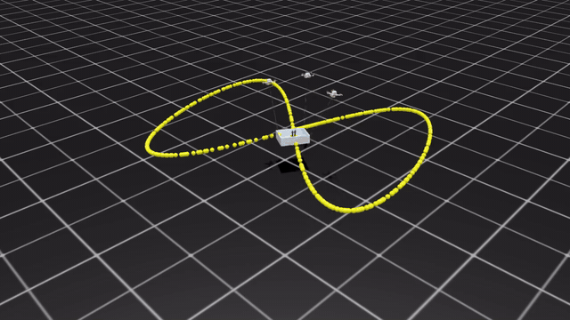
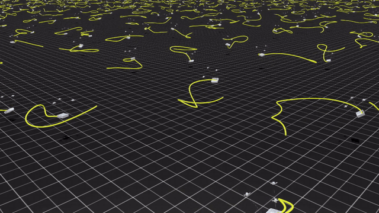

# Imitation Learning for Cooperative Aerial Manipulation


Author: Paco Pronk

This repository contains everything that is needed to train student policies for a team
of drones that carry a load suspended on cables. It defines the Docker image in which
the training runs, and it pins the two code repositories as submodules, at versions that
work together:

- [CAML Lab](https://github.com/Aerial-Manipulation-Lab/IL_cooperative_aerial_manipulation_ext)
  is the Isaac Lab extension that trains and validates the students.
- [Batched CAML NMPC](https://github.com/Aerial-Manipulation-Lab/batched_caml_nmpc) is
  the NMPC that the students learn to imitate, and runs in many simulated environments
  at the same time.

[](media/figure_8_flight_student.mp4)

*A student flies the load along a figure eight in Isaac Lab. The yellow dots show the
reference trajectory of the load. Click the image to watch the whole flight.*

[](media/random_walks_512_envs.mp4)

*512 flycranes fly random walks at the Fast level side by side, and all of them are flown by
the same student. The yellow line shows the next 5 seconds of the reference trajectory of
each load. Click the image to watch the video of 18 seconds.*

## Requirements

- An NVIDIA RTX GPU with a recent driver
- Docker with Docker Compose
- The NVIDIA Container Toolkit
- Access to the Isaac Lab image `nvcr.io/nvidia/isaac-lab:3.0.0`

## Installation

Clone the repository together with its submodules, and build the image:

```bash
git clone --recursive git@github.com:Aerial-Manipulation-Lab/IL_cooperative_aerial_manipulation.git
cd IL_cooperative_aerial_manipulation
./docker/dev.sh build
```

The image contains Isaac Lab, acados and the Python dependencies. The compose file
mounts this checkout into the container, so changes to the code take effect without
rebuilding the image. The first run that uses the teacher compiles its solver, which
takes about a minute, and caches the result in `.cache/batched_caml_nmpc`. The container
has no GUI, so flights can only be watched as recorded videos.

## Running

The scripts run inside the container, from the root of this repository, and write their
results to `logs/`. For example, to train a student and then validate it:

```bash
./docker/dev.sh run --rm isaac bash -c '$ISAAC_PY \
    IL_cooperative_aerial_manipulation_ext/scripts/dagger.py \
    --student baseline --run_name <run_name>'

./docker/dev.sh run --rm isaac bash -c '$ISAAC_PY \
    IL_cooperative_aerial_manipulation_ext/scripts/validate.py \
    --checkpoint logs/dagger/<run_name>/student.pt'
```

The [README of CAML Lab](https://github.com/Aerial-Manipulation-Lab/IL_cooperative_aerial_manipulation_ext#readme)
describes all scripts and their options.

## Versions

Version 0.1.1 pins CAML Lab v0.1.1 and Batched CAML NMPC v0.1.1, and uses Isaac Lab
3.0.0, acados v0.6.0 and CasADi 3.6.7.

## Licence

See `LICENCE`.
